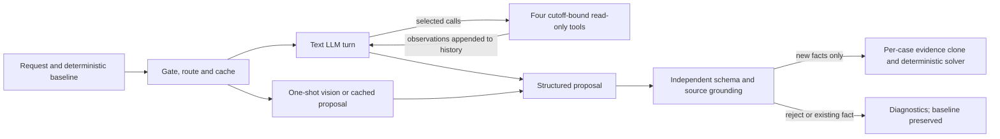

> Historical audit before the agent boundary corrections. Current implementation, live pilot and unchanged accuracy are documented in [agent_corrections_readiness.md](agent_corrections_readiness.md).

# AI investigator implementation and trace audit

Inspected the current ai_auditor.py, providers.py, proposals.py, investigator.py, solver
handoff, historical application run reports and per-call usage journal. Audit only: no
solver/provider/validator changes, no new model requests, no dataset modifications.

## 1. Is it a genuine agent?

**The text path is a bounded multi-step tool-using agent. The vision path is one-shot
structured extraction.** Calling the entire implementation a one-shot wrapper is incorrect;
calling every path autonomous iterative investigation would also be incorrect.

ai_auditor.py:160-204 maintains a messages conversation. At each non-final turn the LLM
receives the four tool schemas and selects function names/arguments. The runner validates
and dispatches calls, appends the assistant call and tool responses, and calls the LLM again.
The default is three model turns: at most two tool-request turns followed by a forced final
JSON turn. Several calls can be chosen in one batch; those calls do not see each other's
results until the next model turn. Provider retries are additional attempts, not agent turns.

The model may return valid proposal JSON early. Case selection, provider routing, cache use,
limits and the final stopping condition are deterministic. This is one agent with four tools,
not a multi-agent system. Initial trace_identity() is preloaded by the host; some models
redundantly call it again. vision() makes one generateContent request (or reuses its cache),
with no tool loop. The model cannot autonomously request an image through the four tools.

There is currently **no grounding-rejection feedback edge from F to C**.

## 2. Autonomy and tool scope

The four methods in investigator.py are real read-only tools:
- search_evidence: exact identifiers, resources, file IDs and literal asset filenames.
- trace_identity: cutoff-filtered identifier versions and existing resource ownership.
- inspect_timeline: admissible resource observations with direct_state annotations.
- explain_policy: supplied policy rule, or the contract's data-flow treatment.

The dispatcher is an explicit allowlist and results are deep copies. Each evidence query
checks both capture availability and embedded observation time against the fixed case
cutoff. There is no arbitrary shell, filesystem, network or effectful deletion tool.
providers.py sends accumulated tool messages to DeepSeek and translates them into Gemini
function responses, preserving Gemini's native assistant parts/thought signatures in memory.

Tool selection is autonomous within these boundaries. The host does not script a fixed
search -> timeline -> policy chain. It does constrain eligible cases: cases with no baseline
issues or no already grounded resource candidate are skipped. Also, ground_fact requires
preexisting unique ownership. Consequently this implementation cannot independently solve
an entirely unlinked subject-resource relationship, despite having an identity lookup tool.

## 3. Concrete live execution evidence

### Gemini case_07: actual adaptive two-hop retrieval

Source: artifacts/ai_iteration/gemini_fixed_sample.json, agent event beginning at line 20263.
There are three successful model calls, no provider errors and no invalid-response repair:

| Model turn | Observed action | Input/output tokens |
| --- | --- | ---: |
| 1 | search_evidence(kind=email, value=priya.raman@gmail.com) | 7573 / 108 |
| 2 | search_evidence(kind=asset_reference, value=delivery_confirmation_19.pdf) | 9715 / 54 |
| 3 | Structured LINK_ASSET proposal | 10744 / 393 |

The first result contains activity_4007, whose details supply the exact filename and
sole-owner association. That filename is absent from the stored baseline diagnostic.
The next query retrieves evidence_46:image:ocr_context, containing the original object
listing. The final proposal cites evidence_46 for presence and activity_4007 for ownership.
These two one-tool turns are reconstructed from the implemented loop, two tool entries,
three successful calls and absence of invalid-response entries; the original trace does
not explicitly label round boundaries. This is evidence of result-dependent investigation,
not a counterfactual experiment proving the model could never have guessed the filename.

The proposal is rejected: category OBJECT_STORAGE_FILE is not SUPPORT_ATTACHMENT. The
generic ASSET_REFERENCE_OR_SOLE_OWNERSHIP_UNPROVEN error obscures this precise cause.
DeepSeek case_07 made the analogous category error OBJECT_STORAGE_LISTING.

An **offline validator replay**, not a new model call, changed only category to
SUPPORT_ATTACHMENT. All unchanged grounding checks then passed. The current deterministic
baseline already contains the equivalent observation
evidence_46:image:ocr_context:catalog:activity_4007. Thus fixing this old model formatting
error now would not prove incremental solver improvement. Replay details are preserved in
artifacts/agent_audit/validator_replay.json; trace extract in case07_trace_extract.json.

### DeepSeek case_07: tool-argument error recovery and budget exhaustion

Source: artifacts/ai_iteration/deepseek_sample.json, event line 20491. Resource searches
without system_id return 'Resource searches require system_id'. A subsequent search adds
system_id=object_storage, and an asset-reference search finds the listing. Later timeline
requests return TOOL_BUDGET_EXHAUSTED. The original pilot also requested explain_policy for
SUPPORT_ATTACHMENT, but that call was denied at the tool budget. Useful behavior includes
recovering from a tool error and finding a catalog/listing link; no fact was ultimately applied.

### case_17: real observation retrieval, but accepted facts already existed

DeepSeek event: deepseek_sample.json line 21139. Three model calls; accepted observations
evidence_01:line:21, evidence_67:line:3 and evidence_01:line:53 all have new_fact=false.
The tombstone activity-as-state proposal and an audit-record timestamp are rejected.
Gemini event: gemini_fixed_sample.json line 20575. It accepts evidence_01:line:21 with
new_fact=false; rejects a backup timestamp; repairs a fenced-JSON intermediate response
before returning schema-valid final JSON. Format repair is feedback, grounding repair is not.

### case_06 and case_63: useful limits, not solved-by-AI examples

Gemini case_06 rediscovers search_001 in evidence_57 and accepts an existing observation;
the comparison report uses a cache hit, so it is not a new live invocation in that run.
DeepSeek case_06 uses identity, search, timelines and explain_policy(SEARCH_INDEX_ENTRY),
but finishes with INVALID_FINAL_JSON.

The live vision case_63 event in vision_fixed_full.json at line 216279 uses one call:
3076 input / 329 output tokens. It extracts sj.park@naver.com from evidence_60, but the
request is for the catalog-linked user_09. Validation returns
VISIBLE_IDENTIFIER_NOT_EXACTLY_CORROBORATED. That demonstrates extraction and a working
validation boundary, not autonomous multi-step vision or a resolved identity conflict.

## 4. Why there is no incremental sample accuracy gain

1. REUSE_DIRECT returns the original observation. The investigator records acceptance but
   excludes its existing observation_id from additions. Solver reruns only if the returned
   accepted-new-observation list is nonempty (solver.py:260-269).
2. LINK_ASSET is the only current text interpretation capable of creating new observations.
   Actual attempts failed category/quote/source checks. Those failures are not fed back to
   the model after schema-valid JSON has ended the loop.
3. Vision requires existing category/state and exact identifier corroboration; it cannot
   assert a new unsupported state. Its successful branch returns replace(source, scope=...)
   **with the same observation_id**, so ai_auditor.py:262 filters even a valid scope-only
   corroboration from additions. It currently has no effective novelty path into the solver.
4. The eligibility gate omits cases without resource candidates and cases marked sufficient.
   It therefore does not investigate every sample exact-match failure. Tools expose parsed
   observations, not arbitrary source exploration or an unrestricted identity-link mechanism.
5. Some gaps are real missing ownership/cutoff/hidden-field problems. More fluent summaries
   cannot supply admissible facts. Final summaries/hypotheses are not themselves validated
   evidence and can overstate what the accepted fact set establishes.
6. The later deterministic artifact adapter now covers the strongest historical agent lead.
   Its full-coverage improvement belongs to that deterministic change, not the earlier rejected
   model proposal. Its public-sample precision tradeoff also must not be called an AI gain.

No inspected run demonstrates newly accepted AI evidence producing a sample accuracy lift.
Useful search, error recovery, uncertainty reporting and safe rejection are weaker, distinct
claims. A different observation_id alone is also insufficient novelty: measure equivalent
resource/source/state facts against the baseline, not just string IDs.

## 5. Trace sufficiency and concrete defects

Sufficient for a basic tool-use demonstration: ordered tool names, arguments, compacted
results, final facts/hypotheses/reasoning summaries, accepted/rejected proposals and reasons,
provider/model, token/cost/latency records, cache-vs-live distinctions and original source IDs.

Not sufficient for a fully reproducible per-turn causal audit: tool_trace is flattened;
round IDs, provider call IDs, assistant tool batches, exact supplied prompt/context hashes,
per-turn timestamps and short tool-choice rationales are absent. Ordinary assistant messages
and Gemini thought signatures are not persisted in these application reports. Usage journals
record reservations/completions, not conversation contents. The older interrupted pilot has
missing usage, and one initial malformed DeepSeek final lacks raw text. Native coding-session
transcripts do not replace these application-level records. Hidden chain-of-thought is neither
required nor recommended; brief decision summaries and source IDs suffice.

**Verified context-truncation bug:** compact() silently trims every list to 12 items and
every string to 2000 characters. In DeepSeek case_17, search_evidence returns total=13 and
truncated=false, but the recorded/model-visible observations array has only 12 entries.
The tools sort oldest-first; silent compaction can hide a later readback while reporting a
complete result. This is a context-coverage defect, not demonstrated causal accuracy loss.

The resource-search schema also makes system_id optional even though runtime requires it
for kind=resource. Actual invalid calls consume the limited budget. Category is a free string
in the proposal schema despite grounding requiring exact supplied policy categories.

## 6. Smallest safe improvement and honest success criteria

First repair truthful bounded tool-result presentation: preserve the actual shown count,
mark truncation whenever compaction removes observations, and let the model retrieve a
specific resource/readback rather than silently losing it. Log round/tool-call IDs and a
brief next-action summary. These changes affect the agent context/trace, not solver policy
or evidence validation. The existing case_17 trace provides a reproducible regression input.

The smallest proposal-quality improvement is to constrain category to the supplied policy
vocabulary and explicitly require SUPPORT_ATTACHMENT for LINK_ASSET. Preserve all grounding
checks. If a schema-valid proposal arrives with turns still available, return precise
grounding errors for one correction **within the existing turn/cost limits**. Do not add
unbounded reflection or accept an interpretation merely because the model repeats it.

Measure in paired baseline/agent runs: tool-result coverage, invalid-call rate, corrected
proposal rate, unique new source-grounded facts, resolved gaps and actual prediction/metric
delta. The existing case_07 replay proves a recoverable categorical error, but it is already
covered by today's deterministic solver; it cannot serve as a new accuracy win. Do not
disable working deterministic extraction to manufacture an agent contribution.

There is **no demonstrated one-line change guaranteeing higher accuracy on the current
32 samples**. A genuine accuracy claim requires an admissible fact not already in the
baseline, successful unchanged validation and a measured output improvement. If a bounded
pilot still finds only duplicates or unavailable evidence, report zero incremental gain.
