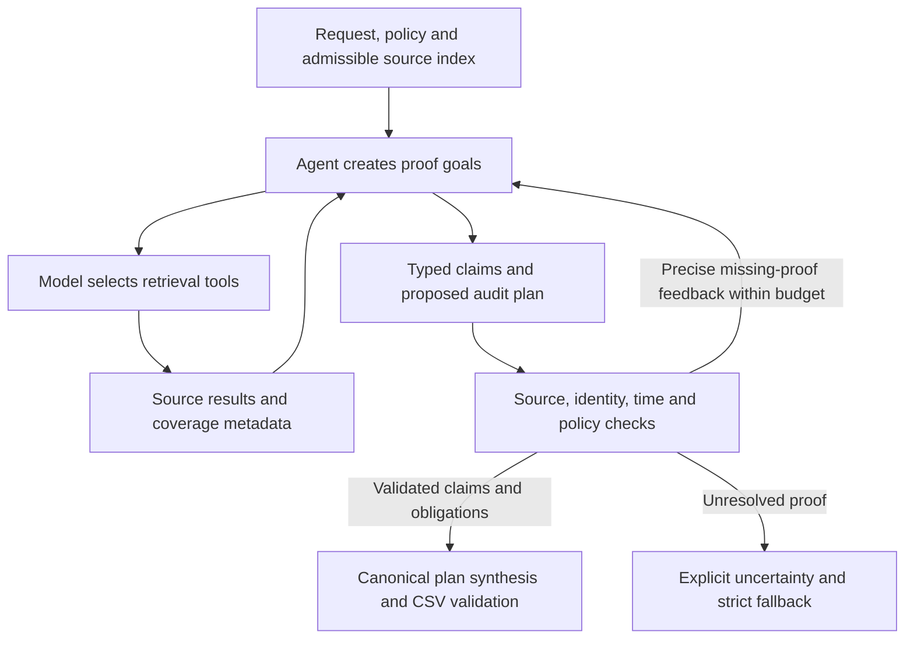

# Agent-native gap analysis

This is a source-based architecture review, not a new execution benchmark. No solver,
dataset, provider budget, predictions or submission archive was changed for this review.
Proposed changes below are not implemented. Historic run measurements are identified.

## Contract and the central distinction

The official local problem statement asks for an "AI-powered deletion audit agent"
(problem_statement.md:7). Its closing instructions explicitly encourage "deterministic
verification" (line 162). Therefore deterministic processing is allowed. There is no
local instruction requiring every task to use an LLM. The rubric describes correctness
of status, identity, discoveries, citations, policy and plan completeness (line 131);
it does not promise a score bonus for more calls or a greater fraction of LLM code.

The relevant question is who controls investigation and semantic interpretation.
Parsing JSON, resolving exact keys, enforcing cutoff times, checking provenance, sorting
steps and validating the CSV should stay executable and reproducible. Understanding
unfamiliar business artifacts, generating hypotheses, identifying relevant policy
conditions, seeking counterevidence and deciding what to inspect next are suitable
agent responsibilities. An LLM deciding whether to ignore a cutoff is not adaptability.

## What the implementation actually does

1. solver.py:263-275 computes deterministic decisions and routing before investigation.
2. ai_auditor.py:207-213 supplies baseline diagnostics and identity in the initial context.
3. The model chooses tools, sees returned results and may follow leads. This is real
   multi-step tool use, not a one-shot wrapper.
4. recommendations.py:90 independently reruns decide_case on the grounded local store.
   Lines 131-145 check the proposed verdict and compare the complete step multiset,
   including citations, against that computed decision.
5. solver.py:278-282 reruns the canonical solver only when investigation returns grounded
   observation updates. A different recommendation alone does not change output.

Consequently this is currently a deterministic audit engine with an adaptive investigator
and an audit-recommendation reviewer. It is not yet an agent-led audit with independently
checked proof certificates. New exact identity links, literal field extraction and valid
metadata enrichments can change results; it is incorrect to say change is impossible.
However, a better policy interpretation or alternative plan has no independent acceptance
path unless it can first become an observation update recognized by the same engine.

Agreement with the current engine is an acceptance criterion, not independent evidence
that its semantic interpretation is complete. Source/cutoff checks are essential;
whole-plan equality is a separate, stronger restriction. This coupling limits corrections
to errors the existing observation-to-policy engine can already express.

## Why the measured incremental gain is zero

Facts from artifacts/proof_quality/summary.json and the recorded Markdown execution report:

- Latest pilot investigated one sample, case_29: four calls, 52,098 input and 8,079 output
  tokens. It did not test live agent behavior on all 32 samples or all 518 full requests.
- Four policy calls used four of six successful tool slots. Two source inspections used
  the remainder; search and support source inspections were denied by the tool budget.
- The final recommendation proposed INCOMPLETE but omitted the search_1993 finding.
  Independent validation rejected the complete plan. Nine ledger entries were accepted,
  four unresolved; neither accepted ledger text nor duplicate facts changed predictions.
- The full sample CSV remained identical to baseline. The final output materialization
  made zero new calls. These are zero incremental gains, not zero AI accuracy.

Source-supported constraints explaining the result:

- Baseline exposure can anchor the model; it is present in the prompt. The magnitude of
  anchoring has NOT been established by a controlled comparison.
- New semantic interpretations must fit a narrow grounded-fact vocabulary and the same
  policy engine. Rejected disagreement is not automatically a model error.
- agent_context.py:20-65 decides eligibility before the model, including labels such as
  irreducible. Those labels are routing judgments, not a proof that all raw evidence has
  been exhaustively searched. Context leads principally cover untyped/missing-data sources
  (lines 78-94), which can underprioritize wrongly classified existing observations.
- ai_auditor.py:223 forces finalization after tool exhaustion or one correction. Feedback
  can identify missing evidence when no retrieval turn remains; correction then repairs
  text but cannot obtain additional proof.
- Some evidence gaps remain genuine. Adaptability cannot make missing restore permission
  or conflicting subject identity become known. Preserve those uncertainties.

Thus "the closed corpus and strong baseline explain everything" is too broad. Observed
zero gain also reflects limited live coverage, tool allocation and the acceptance/handoff
design. Their relative causal contributions have not been measured.

## Minimal path to agent-led auditing

Keep the current strict and submission artifacts frozen; implement an opt-in experimental
mode incrementally, without replacing the existing provider loop or adding a framework.

| Priority | Change | Independent acceptance boundary | Measurement |
| --- | --- | --- | --- |
| 1 | Separate proof errors from baseline disagreement | Source existence, exact linkage, cutoff, operation validity remain hard checks; disagreement is separately reported | Valid alternative interpretations incorrectly rejected; paired output differences |
| 2 | First-pass investigation receives request, policy and source index; reveal baseline later for critique | Same source access and cutoff rules; baseline remains available as fallback | Blind agent versus baseline-informed agent on identical requests |
| 3 | Agent submits typed semantic proof certificates, not only a full recommendation | Check resource-bound source spans/JSON pointers, time, scope, condition operands and applicable rule; model prose never establishes a fact | Newly accepted nonduplicate conditions and downstream plan effects |
| 4 | Validate plan steps and coverage separately; synthesize supported components | Accept individually proven operations, reject unsupported ones, require independently enumerated obligations; retain fallback if scope is unproven | Supported partial proposals preserved, missing verification count, precision |
| 5 | Let proof goals guide retrieval allocation and stopping | Reserve retrieval/correction capacity; preload policy table; track explicit uninspected and exhausted leads | Denied useful source calls, evidence coverage, resolved goals per call |
| 6 | Evaluate source-semantic ambiguities, not merely unresolved verdicts | Include declared scoped conflicts and typed observations; no fuzzy identity merges or indiscriminate vision | Useful leads found beyond current routing and counterevidence discovered |

Proof certificates need narrow, independently checkable semantics. Examples: an exact
resource's retention_until value and its comparison with audit_at; a literal shared-record
field; explicit parent ownership; a declared exhaustive replica query. If natural-language
meaning cannot be independently established, preserve a labeled interpretation and unresolved
decision. A second model agreeing is not independent source grounding.

The intended flow is:

Important: replacing whole-plan equality requires actual per-step policy and obligation
validation first. Removing the comparison by itself would weaken correctness. Canonical
ordering must still follow the official contract; alternative citation provenance may be
valid evidence while still differing from a hidden canonical answer. Report these separately.

## Experiment and release criteria

Freeze baseline inputs and hashes. Run three paired modes: existing deterministic baseline,
current baseline-informed agent, and experimental first-pass agent. Evaluate all 32 public
samples; do not insert sample labels into prompts. Use participant-created holdout scenarios
with unfamiliar phrasing, artifact layout and policy conditions, plus future-evidence and
misleading-identity controls. Do not disable working deterministic extraction to manufacture
an AI win. A transformed fixture is a separate robustness test, not a hidden-score estimate.

Measure status, exact case, step precision/recall/F1, field, sequence and strict validity;
also accepted unique facts, accepted conditions, corrected obligations, changed predictions,
improvements/regressions, source coverage, calls/tokens/latency/cost. Attribute effects with
proposal replay: compare the same baseline with and without each accepted update. Do not
attribute all case-level change to every ledger goal. An accepted recommendation that merely
agrees with baseline demonstrates reasoning but not incremental prediction utility.

Do not promise a perfect score or resolution of the eight genuinely unsupported verdicts.
Promote a new mode only after the complete measured comparison preserves grounding and
shows a useful effect. No new calls, runtime changes or new gains were made in this review.

## Corrected interview answer

"Our measured incremental accuracy gain is zero, not the agent's accuracy. The model did
real multi-step investigation, but the latest pilot covered only one sample, exhausted
retrieval capacity and missed one required finding. More importantly, current recommendations
are checked against our own deterministic engine; they mainly affect output through newly
grounded observation updates. This constrains semantic corrections and can anchor the model.
The next experiment is independent first-pass proof planning with source-validated typed
claims and per-step obligation checks. We retain deterministic provenance, cutoff and output
validation, and will claim improvement only if paired evaluation demonstrates it."
